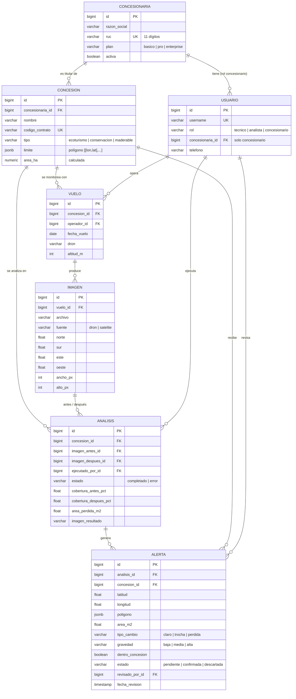

# Base de datos

PostgreSQL, 7 tablas del dominio. Django crea además sus tablas internas: sesiones, permisos y migraciones.

## Decisiones de diseño

- **Revisión dentro de la alerta.** No se creó una tabla aparte para la revisión: la alerta guarda su `estado` (pendiente, confirmada o descartada), quién la revisó y cuándo. Así se cumplen el RF-002 y el RF-003, y la Guía 4 ("pendiente de revisión hasta ser verificada") sin agregar una octava tabla.
- **Geometría en JSON, no en PostGIS.** Los polígonos se guardan como JSON `[[lon, lat], …]` y los cálculos (área, punto dentro del polígono) se hacen en `concesiones/geo.py`. Esto evita instalar PostGIS/GDAL en Windows. Si el proyecto crece, se migra a PostGIS sin cambiar las pantallas.
- **Integridad.** Casi todas las relaciones usan `PROTECT`: no se puede borrar una concesión con vuelos, ni una imagen usada en un análisis. Así se conserva la trazabilidad de la evidencia (RNF-003).
- **Aislamiento por cliente.** El usuario con rol concesionario está ligado a su `concesionaria`, y todas las consultas filtran por ella (`cuentas/permisos.py`).
- **`alerta.concesion_id` está duplicado a propósito** (también se puede llegar a él por `analisis`) para filtrar el historial y el mapa rápido.
